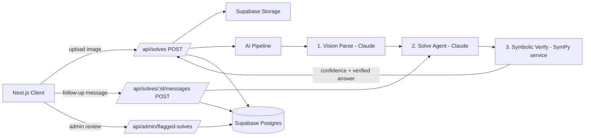

# MathSnap — Engineering Document (High-Level Design)

**Source PRD:** `docs/math-photo-solver-prd.md` | **Status:** Draft — pending engineering approval | **Version:** 1.0 | **Date:** 2026-10-31

---

## 1. Executive Summary

**Project:** MathSnap — a mobile-first web app (Next.js, installable as a PWA) that lets a user photograph a math problem and get a step-by-step solution from a conversational AI agent.

**Business Goal:** Capture the "homework help" moment with a differentiated, conversational (not one-shot) photo-math solver, converting free users to a subscription via unlimited solves and deeper follow-up Q&A.

**Problem Statement:** Students get stuck on math problems with no fast way to see *how* to solve them (not just the final answer); typing math notation is slow and error-prone, and generic chat tools mis-parse handwritten/textbook problems.

**Target Users:** Middle/high school and early-college students (primary), parents helping with homework (secondary), tutors/teachers (tertiary, read-only), plus an internal admin/reviewer role for quality control.

**Success Criteria (from PRD, engineering must support measuring these):**
- Problem recognition accuracy ≥ 95%
- Solve accuracy ≥ 98% (K-12), ≥ 90% (calculus)
- End-to-end solve latency < 10s P95; follow-up latency < 5s P95
- D7 retention ≥ 30%; free-to-paid conversion ≥ 5% in 90 days

---

## 2. Product Scope

### In Scope (MVP + near-term)
- Photo capture (camera) and gallery upload of a math problem image (FR1)
- Image parsing: handwritten, printed, and textbook notation, incl. fractions/exponents/roots/simple diagrams (FR2)
- Step-by-step solving agent with final answer (FR3)
- Conversational follow-up tied to a specific solve (FR4)
- Visual math notation rendering via KaTeX (FR5)
- Low-confidence parse detection with retake/crop prompt (FR6)
- Per-user solve history with topic tagging (FR7)
- Freemium gating (daily solve limit on free tier) and subscription upgrade
- Admin/reviewer flow for user-flagged wrong answers (risk mitigation from PRD §6)

### Out of Scope (this doc)
- Multi-problem detection in a single image (FR8) — Phase 3
- Offline/low-connectivity caching — Phase 3
- Full tutoring curriculum / open-ended lesson generation
- Non-math subjects (physics/chemistry)
- Live human-tutor hand-off
- School/district B2B licensing portal (deferred — open question in PRD §9)

### Future Enhancements (Phase 3+, tracked but not designed here)
- Multi-problem worksheet splitting
- Offline mode with cached recent solves
- Non-math subject expansion
- School/district licensing & FERPA-scoped multi-tenant admin

---

## 3. User Personas

| Persona | Description | Permissions | Primary Workflow |
|---|---|---|---|
| **Student** | Primary user, typically 11–20 years old | Create account, upload/capture photos, view own solves, ask follow-ups, view own history | Photo → solve → follow-up → (optional) save to history |
| **Parent** | Secondary user, same account type as Student (no role distinction in data model — PRD treats them as the same consumer role) | Same as Student | Photo → solve → ask "why this step" follow-up |
| **Teacher/Tutor (viewer)** | Tertiary persona; MVP treats as a Student-type account, no special permissions | Same as Student | Checks a student's work by solving independently |
| **Admin/Reviewer** | Internal ops role, manually provisioned (no public signup) | Read all flagged solves, view original image + parsed problem + agent solution, mark resolved/corrected, cannot access other users' unflagged solves/history | Review queue → inspect flagged solve → resolve/annotate |

---

## 4. User Flows

Format: `User Action → Frontend Behavior → Backend Processing → Database Interaction → System Response`

### 4.1 Sign Up / Auth
`User submits email+password (or OAuth) on /signup` → `Form validates client-side, calls Supabase Auth client SDK` → `Supabase Auth creates auth.users record, triggers DB function to insert public.users profile row with default role='student', free tier` → `INSERT into public.users (id, email, role, subscription_tier, created_at)` → `Session token returned, redirect to /app (home/camera screen)`

### 4.2 Photo Capture → Solve (core flow, FR1–FR6)
`User taps camera button, captures or selects a photo of a problem` → `Frontend compresses/validates image (≤10MB, JPEG/PNG), shows upload progress` → `POST /api/solves with image uploaded to Supabase Storage bucket `problem-images`, backend invokes vision-parse step (Claude) → confidence score computed → if below threshold, return low-confidence response; else invoke solve-agent step (Claude) → symbolic verification step (SymPy service) cross-checks final answer` → `INSERT into solves (user_id, image_url, parsed_problem, topic, steps_json, final_answer, confidence_score, verification_status, created_at)` → `Frontend renders step-by-step solution with KaTeX; if low-confidence, shows "retake/crop photo" prompt instead`

### 4.3 Conversational Follow-Up (FR4)
`User types a question in the chat box under a solved problem` → `Frontend POSTs to /api/solves/:id/messages with message text` → `Backend loads solve context (parsed problem + steps) + prior messages for that solve, sends to Claude with full context, returns grounded clarification (no re-solving from scratch)` → `INSERT into messages (solve_id, role, content, created_at)` → `Frontend appends agent response to chat thread (target <5s P95)`

### 4.4 Solve History & Search (FR7)
`User opens History tab` → `Frontend fetches paginated list, optionally filtered by topic/date` → `GET /api/solves?topic=&from=&to=&cursor=` → `SELECT from solves WHERE user_id=... ORDER BY created_at DESC, filtered by topic/date` → `Frontend renders list grouped by topic; tapping an item reopens the solve + its message thread`

### 4.5 Flag Wrong Answer → Admin Review (risk mitigation, PRD §6)
`User taps "This answer was wrong" on a solve` → `Frontend POSTs to /api/solves/:id/flag with optional free-text reason` → `Backend verifies solve belongs to user, inserts review record` → `INSERT into flagged_solves (solve_id, flagged_by, reason, status='open', created_at)` → `User sees confirmation toast; solve marked "under review" in their history`

### 4.6 Admin Review Queue
`Admin logs in, opens /admin/review` → `Frontend fetches open flags (admin-only route, role checked server-side)` → `GET /api/admin/flagged-solves?status=open` → `SELECT flagged_solves JOIN solves WHERE status='open' ORDER BY created_at ASC` → `Admin views image + parsed problem + agent steps side-by-side, marks resolved/escalated` → `PATCH /api/admin/flagged-solves/:id updates status, reviewer_notes`

### 4.7 Free → Paid Upgrade
`User hits daily free-solve limit` → `Frontend shows upgrade paywall modal` → `POST /api/billing/checkout creates Stripe Checkout session` → `On webhook confirmation, UPDATE users SET subscription_tier='paid', subscription_expires_at=...` → `Frontend unlocks unlimited solves and advanced topics`

---

## 5. Frontend Architecture

**Stack:** Next.js 14 (App Router), TypeScript, Tailwind CSS, React Context + Zustand for client state (active solve session, chat thread state), KaTeX for math rendering, Supabase JS client for auth/storage, PWA manifest for installable mobile experience.

**Page/Component Hierarchy:**
```
app/
├── (auth)/signup, login
├── (app)/
│   ├── page.tsx                 — camera/upload home screen
│   ├── solve/[id]/page.tsx      — solution view + follow-up chat
│   ├── history/page.tsx         — solve history, topic filters
│   └── billing/page.tsx         — upgrade/paywall
├── admin/
│   └── review/page.tsx          — flagged-solve review queue (role-gated)
components/
├── camera/PhotoCapture.tsx, ImageUploader.tsx
├── solve/StepRenderer.tsx (KaTeX), ConfidenceWarning.tsx, FollowUpChat.tsx
├── history/SolveList.tsx, TopicFilter.tsx
├── admin/ReviewQueueTable.tsx, ReviewDetailPanel.tsx
└── shared/Button, Modal, Toast, LoadingSpinner, EmptyState, ErrorBoundary
```

**UX States:**
- **Loading:** Skeleton for history list; animated "solving..." state (steps streaming in as agent produces them) during solve.
- **Empty:** "No solves yet — snap your first problem" on history.
- **Error:** Distinct messaging for (a) upload failure, (b) low-confidence parse (actionable retake/crop CTA), (c) agent/provider failure (retry CTA), (d) network offline.
- **Responsive:** Mobile-first (primary), graceful scale-up to tablet/desktop for the web companion.
- **Accessibility:** Alt text on uploaded images, screen-reader-readable step text alongside KaTeX rendering, sufficient contrast, keyboard-navigable chat input.

---

## 6. Backend Architecture

**Stack:** Next.js Route Handlers (API layer) + Supabase (Postgres, Auth, Storage, Row-Level Security) + a dedicated AI pipeline module invoked server-side.

**Core Systems:**
- **Auth:** Supabase Auth (email/password + Google OAuth), JWT session validated on every API route via Supabase server client.
- **Authorization:** Row-Level Security policies scope `solves`/`messages`/`flagged_solves` to `user_id = auth.uid()`; `admin` role (stored in `users.role`) required for `/api/admin/*` routes, enforced both via RLS and an explicit server-side role check in route handlers (defense in depth).
- **Business logic:** `lib/ai/` module orchestrates the 3-step pipeline (vision-parse → solve → verify); `lib/solves/` module handles persistence and history queries.
- **Validation:** Zod schemas for every API request body (image metadata, message text, flag reason).
- **Middleware:** Rate limiting (per-user, per-IP) on `/api/solves` (upload+solve) and `/api/solves/:id/messages` to control AI cost and abuse; request size limit (10MB) enforced at the upload route.
- **Error handling:** Centralized error handler mapping internal errors (provider timeout, low-confidence, storage failure) to typed API error responses; no silent failures — every failure path returns an actionable message to the frontend.

**Service Interaction Diagram:**



---

## 7. Database Design and Schema

All tables in Supabase Postgres; RLS enabled on every user-data table.

### `users`
| Column | Type | Notes |
|---|---|---|
| id | uuid (PK, FK → auth.users.id) | |
| email | text, unique | |
| role | text, default `'student'` | `'student' \| 'admin'` |
| subscription_tier | text, default `'free'` | `'free' \| 'paid'` |
| subscription_expires_at | timestamptz, nullable | |
| daily_solve_count | int, default 0 | reset via scheduled job |
| created_at | timestamptz, default now() | |

Constraints: `role` CHECK IN ('student','admin'). Index on `email`.

### `solves`
| Column | Type | Notes |
|---|---|---|
| id | uuid (PK, default gen_random_uuid()) | |
| user_id | uuid (FK → users.id) | |
| image_url | text | Supabase Storage path |
| parsed_problem | text | extracted problem text/LaTeX |
| topic | text | e.g. `'algebra'`, `'calculus'` |
| steps_json | jsonb | ordered array of {step_number, explanation, latex} |
| final_answer | text | |
| confidence_score | numeric(3,2) | 0.00–1.00, from vision-parse step |
| verification_status | text | `'verified' \| 'unverified' \| 'failed'` |
| created_at | timestamptz, default now() | |

Constraints: FK `user_id` ON DELETE CASCADE. Indexes: `(user_id, created_at DESC)` for history pagination, `(user_id, topic)` for filtering.

### `messages`
| Column | Type | Notes |
|---|---|---|
| id | uuid (PK) | |
| solve_id | uuid (FK → solves.id) | |
| role | text | `'user' \| 'agent'` |
| content | text | |
| created_at | timestamptz, default now() | |

Constraints: FK `solve_id` ON DELETE CASCADE. Index on `(solve_id, created_at)`.

### `flagged_solves`
| Column | Type | Notes |
|---|---|---|
| id | uuid (PK) | |
| solve_id | uuid (FK → solves.id) | |
| flagged_by | uuid (FK → users.id) | |
| reason | text, nullable | |
| status | text, default `'open'` | `'open' \| 'resolved' \| 'escalated'` |
| reviewer_id | uuid (FK → users.id), nullable | |
| reviewer_notes | text, nullable | |
| created_at | timestamptz, default now() | |
| resolved_at | timestamptz, nullable | |

Constraints: FK `solid_id`→`solves.id` ON DELETE CASCADE. Index on `(status, created_at)` for queue ordering.

**Relationships:** `users 1—N solves`, `solves 1—N messages`, `solves 1—1 flagged_solves` (nullable, created only when flagged).

---

## 8. AI Architecture

**Provider:** Anthropic Claude (multimodal vision + tool use) for both parsing and solving; a lightweight symbolic math verification service (SymPy, run as a backend microservice/edge function) cross-checks numeric/algebraic final answers before they are persisted or shown.

**Pipeline (per solve request):**
1. **Vision Parse step** — Claude receives the uploaded image with a system prompt instructing it to transcribe the math problem (text/LaTeX) and emit a structured confidence score. Output: `{ parsed_problem, topic_guess, confidence }`.
2. **Solve step** — Claude receives the parsed problem (text, not re-reading the image) with a system prompt requiring an ordered JSON array of steps + final answer, each step independently justified (addresses PRD FR3's "not just filler text" requirement).
3. **Symbolic Verification step** — for problem types expressible symbolically (algebra, arithmetic, basic calculus), the final answer is independently recomputed via SymPy and compared to Claude's answer. Mismatch → `verification_status='failed'`, response withheld from user with a "we're double-checking this one" fallback and the solve auto-flagged for review. Non-symbolic problem types (e.g., geometry proofs) skip verification and are marked `'unverified'` — surfaced subtly in the UI as "AI-generated, not independently verified."
4. **Follow-up step** — each follow-up message re-sends the original parsed problem + steps + full message history as context (not the image) to keep responses grounded in the original solution and avoid contradictory re-solving (PRD user story #2 acceptance criterion).

**Context/Memory:** Conversation context is scoped per-solve (not global per-user) — each `solve_id` has its own message thread, re-hydrated from the `messages` table on each follow-up call.

**Token/Cost Controls:** Per-user daily solve cap (free tier) enforced before invoking the pipeline; image payloads capped at 10MB; follow-up context truncated to the most recent N messages + the original solve if the thread grows long; model calls logged with token counts for cost monitoring.

**Rate Limiting:** Per-user and per-IP request throttling on `/api/solves` and `/api/solves/:id/messages` (see §6) to bound AI spend and abuse.

**Fallback Behavior:** Provider timeout/error → typed error response with retry CTA, no partial/garbled solution ever shown; confidence below threshold → retake/crop prompt instead of a solve attempt (FR6); verification failure → withhold + auto-flag rather than show an unverified-but-wrong answer silently.

---

## 9. API Specification

### `POST /api/solves`
- **Purpose:** Upload a problem image and receive a solved, step-by-step response.
- **Auth:** Required (student/admin).
- **Request:** `multipart/form-data` — `image: File` (JPEG/PNG, ≤10MB).
- **Response (200):** `{ id, parsed_problem, topic, steps: [{step_number, explanation, latex}], final_answer, confidence_score, verification_status }`
- **Response (422 — low confidence):** `{ error: "low_confidence_parse", message, suggested_action: "retake_or_crop" }`
- **Validation:** File type/size checked server-side; reject non-image mime types.
- **Errors:** `400` invalid file, `401` unauthenticated, `429` rate-limited (daily cap reached), `502` AI provider failure.

### `POST /api/solves/:id/messages`
- **Purpose:** Ask a follow-up question about a specific solve.
- **Auth:** Required; solve must belong to requester.
- **Request:** `{ content: string }` (1–2000 chars).
- **Response (200):** `{ id, role: "agent", content, created_at }`
- **Validation:** Zod schema enforces length/non-empty.
- **Errors:** `400` invalid body, `403` solve not owned by user, `404` solve not found, `429` rate-limited.

### `GET /api/solves`
- **Purpose:** Paginated solve history.
- **Auth:** Required.
- **Request (query):** `topic?`, `from?`, `to?`, `cursor?`, `limit?` (default 20, max 50).
- **Response (200):** `{ items: [...solve summaries], next_cursor }`
- **Errors:** `401` unauthenticated.

### `POST /api/solves/:id/flag`
- **Purpose:** Flag a solve as incorrect.
- **Auth:** Required; solve must belong to requester.
- **Request:** `{ reason?: string }`
- **Response (201):** `{ id, status: "open" }`
- **Errors:** `403` not owner, `404` not found, `409` already flagged.

### `GET /api/admin/flagged-solves`
- **Purpose:** List flagged solves for review.
- **Auth:** Required, `role='admin'` only.
- **Request (query):** `status?` (default `'open'`), `cursor?`.
- **Response (200):** `{ items: [{ flag_id, solve, flagged_by, reason, created_at }], next_cursor }`
- **Errors:** `403` non-admin.

### `PATCH /api/admin/flagged-solves/:id`
- **Purpose:** Resolve/escalate a flagged solve.
- **Auth:** Required, `role='admin'` only.
- **Request:** `{ status: "resolved" | "escalated", reviewer_notes?: string }`
- **Response (200):** updated flag record.
- **Errors:** `403` non-admin, `404` not found, `400` invalid status.

### `POST /api/billing/checkout`
- **Purpose:** Create a Stripe Checkout session for subscription upgrade.
- **Auth:** Required.
- **Response (200):** `{ checkout_url }`
- **Errors:** `401` unauthenticated, `502` billing provider error.

---

## 10. Feature Breakdown

### Phase 1 (MVP)
- **Photo capture/upload + vision parsing** — Camera/gallery input, Claude vision-parse step. *Acceptance:* ≥95% recognition accuracy on benchmark set. *Dependencies:* Supabase Storage, Claude API access.
- **Solving agent + symbolic verification** — Step-by-step solve with SymPy cross-check. *Acceptance:* ≥98% solve accuracy (K-12). *Dependencies:* parsing step output.
- **Math notation rendering (KaTeX)** — *Acceptance:* all steps render as formatted math, no raw LaTeX text visible. *Dependencies:* steps_json structure.
- **Basic follow-up Q&A (single-turn)** — *Acceptance:* follow-up responses grounded in original solve, <5s P95. *Dependencies:* solve + messages tables.
- **Low-confidence handling** — *Acceptance:* confidence < threshold always triggers retake prompt, never a silent guess.

### Phase 2
- **Solve history + topic tagging/search** (FR7) — *Acceptance:* filterable, searchable, reopens follow-up thread. *Dependencies:* Phase 1 complete.
- **Broader topic coverage (calculus+)** — *Acceptance:* ≥90% solve accuracy on calculus benchmark. *Dependencies:* prompt/model tuning.
- **Admin review queue hardening** — *Acceptance:* reviewers can triage and resolve flags with audit trail. *Dependencies:* `flagged_solves` table, admin auth.
- **Freemium billing (Stripe)** — *Acceptance:* free-tier cap enforced, upgrade flow functional end-to-end.

### Phase 3
- **Multi-problem worksheet detection** (FR8) — *Acceptance:* correctly splits and solves ≥2 problems in one image. *Dependencies:* vision-parse step extended to return multiple problem segments.
- **Offline/low-connectivity caching** — *Acceptance:* last N solves viewable offline. *Dependencies:* PWA service worker, local cache store.
- **School/district licensing** — deferred pending business decision (PRD open question).

---

## 11. Folder Structure

```
mathsnap/
├── app/
│   ├── (auth)/
│   │   ├── signup/page.tsx
│   │   └── login/page.tsx
│   ├── (app)/
│   │   ├── page.tsx                  # home / capture screen
│   │   ├── solve/[id]/page.tsx       # solution + chat
│   │   ├── history/page.tsx
│   │   └── billing/page.tsx
│   ├── admin/
│   │   └── review/page.tsx
│   └── api/
│       ├── solves/route.ts
│       ├── solves/[id]/messages/route.ts
│       ├── solves/[id]/flag/route.ts
│       ├── admin/flagged-solves/route.ts
│       ├── admin/flagged-solves/[id]/route.ts
│       └── billing/checkout/route.ts
├── components/
│   ├── camera/, solve/, history/, admin/, shared/
├── lib/
│   ├── ai/
│   │   ├── visionParse.ts            # Claude vision-parse step
│   │   ├── solveAgent.ts             # Claude solve step
│   │   ├── verify.ts                 # SymPy verification client
│   │   └── followUp.ts               # follow-up message handling
│   ├── supabase/
│   │   ├── client.ts, server.ts, storage.ts
│   ├── solves/
│   │   └── repository.ts             # DB read/write for solves/messages
│   ├── validation/
│   │   └── schemas.ts                # Zod schemas
│   └── rateLimit.ts
├── supabase/
│   ├── migrations/
│   └── rls-policies.sql
├── types/
│   └── solve.ts, user.ts
└── tests/
    ├── unit/, integration/, e2e/
```

---

## 12. Naming Conventions

| Category | Convention | Example |
|---|---|---|
| Files/components | PascalCase for components, camelCase for utils | `PhotoCapture.tsx`, `visionParse.ts` |
| Hooks | `use` prefix, camelCase | `useSolveAgent.ts`, `useFollowUpChat.ts` |
| Services/lib modules | camelCase, grouped by domain folder | `lib/ai/solveAgent.ts` |
| API routes | REST noun-based, kebab-case path segments | `/api/admin/flagged-solves` |
| DB tables | snake_case, plural | `solves`, `flagged_solves` |
| DB columns | snake_case | `confidence_score`, `verification_status` |
| Env vars | SCREAMING_SNAKE_CASE, prefixed by service | `ANTHROPIC_API_KEY`, `SUPABASE_SERVICE_ROLE_KEY`, `SOLVE_CONFIDENCE_THRESHOLD` |
| Config files | kebab-case | `next.config.js`, `rls-policies.sql` |

---

## 13. Testing Strategy

- **Unit (Vitest):** `lib/ai/verify.ts` symbolic-verification logic against known correct/incorrect answers; Zod schema validation; step-rendering/KaTeX formatting utilities. Target: 80%+ coverage on `lib/`.
- **Integration (Vitest + Supabase local/test instance):** API route handlers (`/api/solves`, `/api/solves/:id/messages`, `/api/admin/flagged-solves`) against a seeded test DB, including RLS enforcement checks (user cannot read another user's solves; non-admin cannot hit admin routes).
- **E2E (Playwright):** Full capture→solve flow (mocked AI responses for determinism) validating recognition/solve accuracy gates against a fixed benchmark image set (~500 problems, mirroring the PRD's beta success criteria); follow-up chat flow; flag→admin-resolve flow.
- **Accuracy benchmark suite (custom, non-CI-blocking but tracked):** periodic run of the 500-problem benchmark set against the live solving pipeline to monitor the PRD's ≥95% recognition / ≥98% solve accuracy targets over time.

---

## 14. Specs to Implementation Mapping

| PRD Requirement / Story | Engineering Doc Section(s) | Implementation Files |
|---|---|---|
| FR1 — photo capture/upload | §4.2, §5, §9 | `components/camera/PhotoCapture.tsx`, `ImageUploader.tsx`, `app/api/solves/route.ts` |
| FR2 — image parsing | §4.2, §8 | `lib/ai/visionParse.ts` |
| FR3 — step-by-step solve | §4.2, §8, §9 | `lib/ai/solveAgent.ts`, `app/api/solves/route.ts` |
| FR4 — conversational follow-up | §4.3, §8, §9 | `lib/ai/followUp.ts`, `app/api/solves/[id]/messages/route.ts`, `components/solve/FollowUpChat.tsx` |
| FR5 — math notation rendering | §5 | `components/solve/StepRenderer.tsx` |
| FR6 — low-confidence handling | §4.2, §8, §9 | `lib/ai/visionParse.ts`, `components/solve/ConfidenceWarning.tsx` |
| FR7 — solve history | §4.4, §7, §9 | `app/(app)/history/page.tsx`, `lib/solves/repository.ts` |
| FR8 — multi-problem detection | §10 (Phase 3) | *(deferred — not yet implemented)* |
| User Story — student photo→solve | §4.2 | as above (FR1–FR3) |
| User Story — parent follow-up | §4.3 | as above (FR4) |
| User Story — exam review history | §4.4 | as above (FR7) |
| Risk — math hallucination | §8 | `lib/ai/verify.ts` |
| Risk — wrong-answer human review | §4.5, §4.6, §7 | `app/api/solves/[id]/flag/route.ts`, `app/admin/review/page.tsx`, `flagged_solves` table |
| Risk — COPPA/privacy | §2 (constraint), §6 | *(detailed implementation deferred to `/security-foundation` stage)* |
